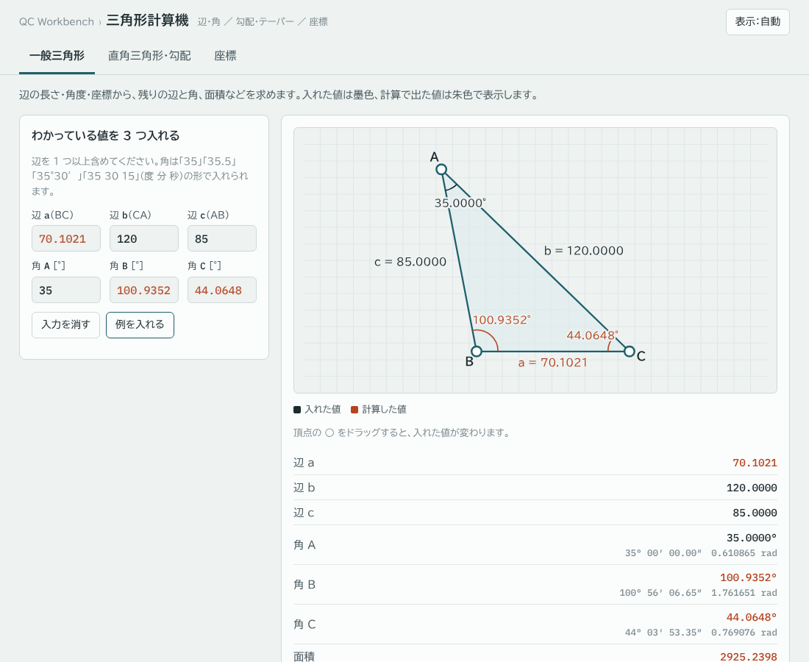
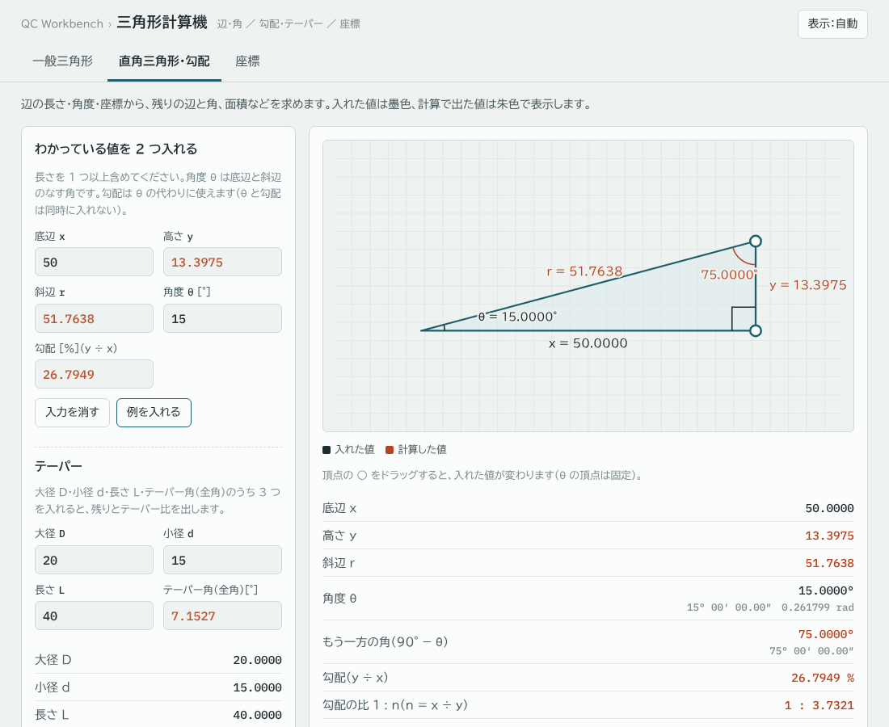
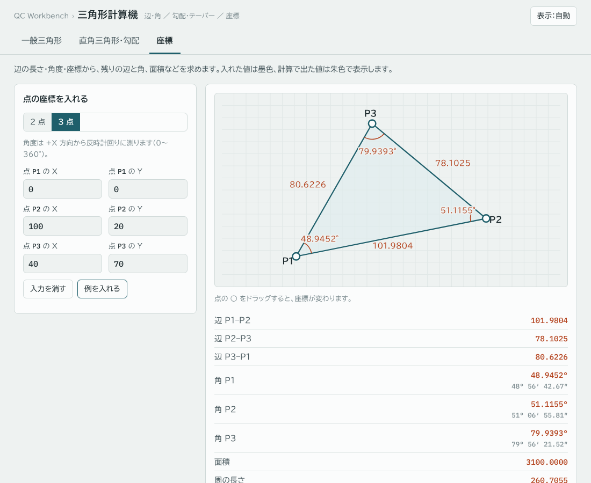

# 三角形計算機（triangle-calc）

辺の長さ・角度・座標から、残りの辺と角、面積などを求める Web ツールです。直角三角形の勾配やテーパーの換算もできます。図の頂点をドラッグすると、形に合わせて値が変わります。

**https://kotaooka.github.io/triangle-calc/**

インストールは不要で、ブラウザで開くだけで使えます。

- **データは外に出ません**。計算はすべてブラウザの中で行い、どこにも送信しません
- 入力した値はこの端末のブラウザに自動で保存し、次に開いたときに続きから使えます
- 一度開けば**オフラインでも動きます**。スマートフォンや PC にアプリとして追加することもできます

---

## できること

入れた値は墨色、計算で出た値は朱色で表示します。空いている欄には計算値が薄く入ります。結果は「結果をコピー（Excel 用）」で、Excel にそのまま貼り付けられる形でコピーできます。

### 一般三角形

辺 a・b・c と角 A・B・C（a は角 A の向かいの辺）のうち、わかっている 3 つを入れます。辺を 1 つ以上含めてください。

| 入れる組み合わせ | 解き方 |
|---|---|
| 3 辺 | 余弦定理で角を求める |
| 2 辺とその間の角 | 余弦定理で残りの辺を求める |
| 1 辺と 2 角 | 角の和 180° と正弦定理 |
| 2 辺とその間にない角 | 正弦定理。**条件に合う三角形が 2 つある場合は両方を出し、切り替えて見られます** |

あわせて、面積・周の長さ・各辺を底辺とした高さ・中線・外接円と内接円の半径を出します。

### 直角三角形・勾配

底辺 x・高さ y・斜辺 r・角度 θ（底辺と斜辺の角）・勾配 %（y ÷ x）のうち 2 つを入れると、残りと sin・cos・tan、勾配の比（1 : n）、面積を出します。勾配は θ の代わりに使えます。

**テーパー**：大径 D・小径 d・長さ L・テーパー角（全角）のうち 3 つから、残りと半角、テーパー比（1 : x）を出します。

### 座標

- **2 点**：ΔX・ΔY、距離、方向角（+X 方向から反時計回り、0〜360°）、勾配
- **3 点**：各辺の長さ、各点の角、面積（座標法）、方向角、点の並び（時計回り・反時計回り）

### 図をドラッグする

頂点の ○ をドラッグすると、入れてある欄の値が新しい形に合わせて書き換わり、残りの値は計算し直されます。値は図の大きさに合わせて切りのよい刻み（辺が 100 前後なら 0.1、角度は 0.1°）に丸めます。

- 一般三角形：3 つの頂点を動かせます。解が 2 つある組み合わせでは、動かした形に近いほうを選びます
- 直角三角形：直角の頂点で底辺、もう一方の頂点で底辺と高さが変わります（θ の頂点は固定）
- 座標：点の X・Y がそのまま変わります

### 角度の入れ方

「35」「35.5」「35°30′」「35°30′15″」「35 30 15」（度 分 秒をスペースで区切る）「35度30分15秒」の形で入れられます。結果には度分秒とラジアンも並べます。

---

## 使うときの注意

- 値が足りないとき・多すぎるときは、画面に必要な数を出します。多いと値どうしが矛盾することがあるので、わかっている値だけを入れてください
- 表示する小数点以下の桁数は、ページ下の欄で変えられます（計算は倍精度の浮動小数点数で行い、表示だけを丸めます）
- スマートフォンでは、図の上に指を置いている間はページがスクロールしません。図の外を触ってスクロールしてください

---

## 計算の検証

計算は外部ライブラリを使わずに実装し、検算テストを付けています（push のたびに GitHub Actions で実行）。

- 3-4-5 の直角三角形・正三角形などの既知の値
- 解き方を変えた突き合わせ（2 辺と挟む角で解いた 3 辺を、3 辺から解き直して角が一致するか。面積を ½bc sin A とヘロンの公式で比べる など）
- 2 辺と挟まない角の 2 解・1 解・直角ちょうど・解なしの判定、入力の誤りの検出
- テーパー（1/50 のテーパーピンなど）、角度の読み取りと度分秒の繰り上がり、座標からの角と面積

開発者向けの情報は [DEVELOPMENT.md](DEVELOPMENT.md) にあります。

## ライセンス

[MIT License](LICENSE)
